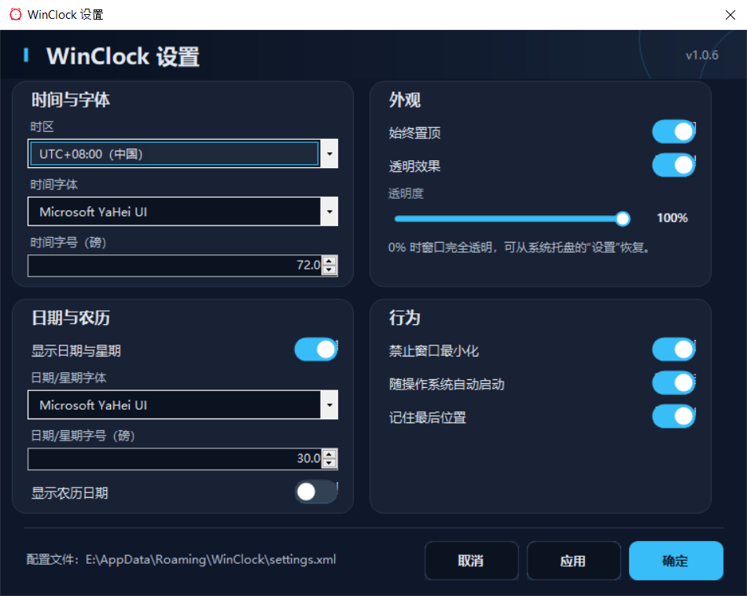

# WinClock 桌面时钟

适用于 Windows 10 / Windows 11 的桌面时钟小组件。无边框、可拖动，支持时间、日期、星期与农历显示，并提供深色设置界面。程序免安装，下载后直接运行。

## 界面预览

### 桌面时钟


### 设置窗口



## 功能特性

- 显示时间、日期、星期，可选显示农历日期。
- 时钟、日期、星期与农历文字使用固定的自定义颜色，不再随桌面颜色动态变化；内置白、黑、红、绿、蓝五种预设，支持十六进制自定义颜色。
- 无边框透明窗口，可在右键菜单中启用拖动；首次运行贴靠主屏幕右上角。
- 深色卡片式设置界面，窗口高度随内容自适应，布局紧凑。
- 支持始终置顶、透明度调节与开机自启动。
- 支持多显示器：记住最后位置并按原显示器恢复。
- 运行后驻留系统托盘；托盘图标与时钟窗口使用同一套右键菜单。
- 右键菜单可直接切换移动、隐藏秒数、置顶状态，并放大/缩小字号。
- 配置保存在用户目录，无需管理员权限。

## 右键菜单（时钟窗口 / 系统托盘）

在时钟窗口或系统托盘图标上点击鼠标右键，两处打开的是同一套菜单，菜单项集合、排列顺序、勾选状态与点击后的行为完全一致，按以下顺序排列：

- **允许移动**：启用后可用鼠标左键拖动时钟窗口，并在此项前显示“✔”；再次点击取消拖动，同时移除“✔”。默认关闭（不可拖动）。
- **始终置顶**：与设置窗口“外观”卡片中的“始终置顶”为同一开关，启用时显示“✔”。任一处修改后，两处状态立即同步。
- **隐藏秒数**：默认关闭（无“✔”）。启用后显示“✔”，时间格式由 `HH:mm:ss` 变为 `HH:mm`；为保持整体对齐，日期与星期同时由 `yyyy年MM月dd日 星期x` 变为 `MM-dd 星期x`。若开启了农历，农历日期同时由长格式变为短格式（例如长格式 `农历乙巳（蛇）2025年十月十五` 变为 `十月十五`，闰月保留“闰”字，如 `闰六月初一`）。再次点击取消“✔”，时间恢复为 `HH:mm:ss`，日期恢复为 `yyyy年MM月dd日 星期x`，农历恢复为长格式。
- **放大**：时间字号与日期/星期字号同时乘以 1.25，例如 36 → 45、20 → 25，新尺寸立即生效。
- **缩小**：时间字号与日期/星期字号同时乘以 0.75，例如 36 → 27、20 → 15，新尺寸立即生效。
- **设置**：打开设置窗口。
- **退出**：退出程序。

“允许移动”“始终置顶”“隐藏秒数”“放大”“缩小”的操作结果会立即写入配置文件，重启程序后仍然有效。从托盘菜单操作时，“隐藏秒数”“放大”“缩小”同样即时作用于时钟窗口并保存，下次启动沿用相同状态。隐藏秒数只改变显示格式，不改变“显示日期与星期”“显示农历日期”两个开关；对应开关关闭时，该行文本不显示，格式切换也不产生额外空行。

## 设置窗口说明

打开方式：右键系统托盘中的 WinClock 图标，或右键时钟窗口，选择“设置”。

设置窗口顶部为“WinClock 设置”标题，正文按功能分为四个卡片区域：

### 时间与字体

- **时区**：时钟显示所使用的时间偏移，默认 `UTC+8`（中国）。
- **时间字体**：设置时间数字使用的字体。
- **时间字号（磅）**：设置时间数字大小，单位磅。

### 外观

- **时钟文字颜色**：时间、日期、星期与农历文本统一使用该固定颜色，默认白色 `#FFFFFF`。点击白、黑、红、绿、蓝五个色块可快速选择，也可在右侧输入框填写十六进制颜色（支持 `#RRGGBB`、`RRGGBB` 与 `#RGB`，例如 `#FF0000`）。格式无效时点击“应用”或“确定”会提示错误并阻止保存。预设色值：白色 `#FFFFFF`、黑色 `#000000`、红色 `#FF0000`、绿色 `#00B050`、蓝色 `#0070C0`。
- **始终置顶**：时钟窗口保持在其它窗口上方，默认启用。
- **透明效果**：启用窗口透明，默认启用。
- **透明度**：0%–100%，默认 70%。设置为 0% 时窗口完全透明，可从系统托盘的“设置”恢复。

> 文字颜色固定后不再随桌面颜色变化；窗口背景仍按桌面像素动态取透明键以保持无边框透明效果。若取到的背景色与文字颜色完全相同，程序会自动微调透明键，避免文字被透明区域吞掉。

### 日期与农历

- **显示日期与星期**：默认启用。
- **日期/星期字体**：日期、星期与农历共用的字体。
- **日期/星期字号（磅）**：日期与星期字号，农历跟随此字号。
- **显示农历日期**：默认关闭。

### 行为

- **禁止窗口最小化**：阻止时钟窗口被最小化，默认关闭。
- **随操作系统自动启动**：登录系统后自动运行，默认启用。
- **记住最后位置**：默认启用。关闭程序时记录时钟位置，下次启动时恢复到该位置；多显示器环境下会按显示器设备名恢复，原显示器不可用时自动回退到最近的可用屏幕。

### 操作按钮

- **应用**：保存设置并立即生效，不关闭窗口。
- **确定**：保存设置、立即生效并关闭窗口。
- **取消**：放弃尚未应用的修改并关闭窗口。

窗口底部显示当前配置文件路径。界面不提供实时预览，修改在点击“应用”或“确定”后生效。

## 设置项与默认值

| 设置项 | 默认值 | 说明 |
| --- | --- | --- |
| 时区 | UTC+8 | 可选 UTC−12 至 UTC+14 |
| 时间字体 | Microsoft YaHei UI | 时间数字字体 |
| 时间字号 | 35 磅 | 范围 6–160 磅 |
| 时钟文字颜色 | `#FFFFFF` | 时间、日期、星期、农历统一颜色 |
| 允许移动 | 关闭 | 仅时钟右键菜单，启用后可拖动窗口 |
| 隐藏秒数 | 关闭 | 仅右键菜单，启用后时间显示 `HH:mm` |
| 显示日期与星期 | 启用 | 日期与星期显示开关 |
| 日期/星期字体 | Microsoft YaHei UI | 日期、星期、农历共用 |
| 日期/星期字号 | 12 磅 | 范围 6–160 磅 |
| 显示农历日期 | 关闭 | 农历文本显示开关 |
| 始终置顶 | 启用 | 窗口置顶 |
| 透明效果 | 启用 | 窗口透明开关 |
| 透明度 | 70% | 0%–100% |
| 禁止窗口最小化 | 关闭 | 拦截最小化操作 |
| 随操作系统自动启动 | 启用 | 写入当前用户启动项 |
| 记住最后位置 | 启用 | 下次启动恢复上次退出位置 |

## 配置与持久化

设置保存在：

```text
%APPDATA%\WinClock\settings.xml
```

- 点击“应用”或“确定”后立即写入并生效，重启程序后继续有效。
- 时钟窗口与系统托盘的右键菜单操作会即时写入同一配置文件，其中移动状态保存为 `AllowMove`，隐藏秒数状态保存为 `HideSeconds`。
- 文字颜色以 `ClockTextColor` 保存为 `#RRGGBB` 字符串，重启后继续沿用。
- 窗口位置以 `WindowX`、`WindowY` 与 `ScreenDeviceName` 保存在同一配置文件中，由程序自动维护。
- 开机自启写入当前用户注册表 `HKCU\Software\Microsoft\Windows\CurrentVersion\Run`，无需管理员权限。
- 配置文件写入采用临时文件替换方式，避免写入中断导致配置损坏。

## 运行与退出

1. 运行 `winclock.exe`，时钟显示在屏幕右上角。
2. 在时钟窗口右键菜单中选择“允许移动”，之后按住时钟窗口任意位置即可拖动到所需位置。
3. 右键时钟窗口或系统托盘图标，两处菜单一致；选择“设置”进行配置，选择“退出”关闭程序。

## 开发环境

- Visual Studio 2022
- .NET Framework 4.8
- C# / Windows Forms

## 本地构建

```powershell
msbuild winclock.sln /p:Configuration=Release /p:Platform="Any CPU"
```

生成文件：`winclock\bin\Release\winclock.exe`。

## 自动构建与发布

仓库包含 GitHub Actions 工作流 `.github/workflows/release.yml`。推送符合 `vX.Y.Z` 格式的 tag 后自动编译并发布：

```powershell
git tag v1.0.0
git push origin v1.0.0
```

工作流会生成 `WinClock_v1.0.0.exe`，版本号与 tag 一致，并附加到对应的 GitHub Release。

## 许可证

本项目基于 [Apache License 2.0](LICENSE) 开源。